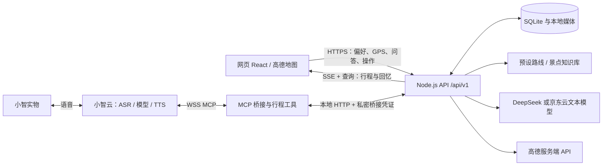

# 栖霞山随身文旅智能体 · AI Tour Guide Device

当前应用版本：**0.5.2-20261031-photo-r12**。React 网页、Node.js 行程后端、小智 MCP 工具共用同一份行程状态。仓库同时保留原有设备工程和外壳建模资料。

本次完整实现位于 **`codex/full-implementation-photo-r12`** 分支；`main` 保留上传前版本。

## 当前功能与边界

| 模块 | 当前实现 |
| --- | --- |
| 路线 | 按进出门、时长、体力、老人/儿童偏好筛选预设，最多 3 条；不临时编造路线。导航可用性取决于道路资料完整度。 |
| 导航 | 高德地图、浏览器定位、地点/下一站/剩余时间、到访/跳过、暂停/恢复、结束与历史。手机后台或锁屏可能停止定位。 |
| 网页与小智 | 8 位配对码绑定行程；工具共用位置、路线、知识讲解和旅行笔记。小智云负责 ASR、模型工具选择和 TTS。 |
| 沉浸体验 | 栖霞寺和包含它的路线显示标签；靠近时网页提示；问位置/下一站时小智可附带体验提示。未接独立主动播报。 |
| 旅行回忆 | 到访、交互、笔记、沉浸选择记录，事实统计与模型摘要，历史、TXT 导出和删除。 |
| 专属手账 | 按用户决定恢复初始演示：本地照片预览并输出固定纪念卡。**没有 AI 照片转贴纸功能**。新服务器照片创作停用，旧记录读取/下载/删除保留。 |
| 动态资讯 | 今日红叶与近期活动资料接入暂缓，不把常识或空资料当作实时信息。 |

## 交互架构



## 目录

- `frontend/`：网页、素材、集成后的栖霞寺体验、测试与构建。
- `backend/`：HTTP API、SQLite、业务模块、小智 MCP、知识库与测试。
- `shared/`：前后端共用规则。
- `docs/architecture/backend/`：设计与实现契约，历史设计不代表全部已上线。
- `docs/operations/`：发布记录与[当前安装部署说明](docs/operations/current-release-setup.md)。
- `stopwatch-nav/`：原有 Android App、固件、协议与测试；该通路不等于小智 MCP 功能，详见其硬件状态文档。
- `modeling/`：外观、模型工程和交付，见 [modeling/README.md](modeling/README.md)。

## 本地运行

使用 **Node.js 22.22+ 或 24**（内置 SQLite、WebSocket）、npm。模型大文件使用 Git LFS，应用开发不依赖建模素材。

```sh
git clone --branch codex/full-implementation-photo-r12 https://github.com/WuJiaxuan1/ai-tour-guide-device.git
cd ai-tour-guide-device
npm --prefix backend ci
npm --prefix frontend ci
```

将根目录 `.env.example` 复制为 `.env.local`，填写自己的高德和文本模型配置。密钥只存服务端，不放入 `VITE_*` 或 Git。缺少配置时相关外部服务不可用。

分别在两个终端启动：

```sh
npm --prefix backend start
npm --prefix frontend run dev
```

后端默认 `127.0.0.1:8787`，网页地址以 Vite 输出为准；Vite 代理 `/api` 和 `/_AMapService`。手机定位需要有效 HTTPS 和用户授权。

```sh
npm --prefix backend test
npm --prefix frontend test
npm --prefix frontend run build
```

构建输出 `frontend/dist/client/`，运行后端即可托管。须保留完整 `backend/`、`shared/` 与 `frontend/src/`（后端读取景点目录），不能只上传 dist。

## 小智连接

私有 `.env.local` 配置 `MCP_ENDPOINT`、`QIXIA_MCP_SECRET` 和 `QIXIA_API_BASE`，从仓库根目录运行：

```sh
node --env-file=.env.local backend/integrations/xiaozhi/mcp_pipe.mjs -- node backend/integrations/xiaozhi/trip-stdio.mjs
```

同一 MCP 接入点只运行一个桥接实例。网页开始行程 → 向小智索取配对码 → 网页输入 8 位码 → 询问“下一站去哪”。设备固件、云端账号、模型和语音配置须在自己的环境准备，仓库不含账号凭证。

## 数据与版本记录

运行数据写入 `.local-work/`，包括 SQLite、旅行媒体与历史照片作品。发布应持久化并备份，不能随代码替换而丢弃。源码仓库不含私人数据、密钥、依赖目录或可重新生成的构建产物。

当前状态以本 README、[安装部署说明](docs/operations/current-release-setup.md) 和 [photo-r12 发布记录](docs/operations/deployment-20261031-photo-r12.md) 为准。旧文档中的 FastAPI、主动语音、照片生成或“未推送”等是当时设计/状态；不把自动测试等同于景区实测。原有硬件文档和工程继续保留，官方手册不随仓库复制。
