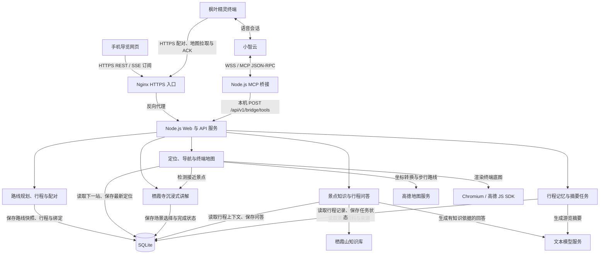

# 枫叶精灵｜随身文旅导览智能体

枫叶精灵是一套为南京栖霞山设计的随身文旅导览系统。游客在手机网页上规划路线并开启游览，再通过配有定制 3D 打印外壳的枫叶精灵终端查看下一站路线、用语音询问景点与行程。游览中可以体验栖霞寺互动故事，结束后可在网页回看本次行程。


[实机演示与建模打印成品视频](https://github.com/WuJiaxuan1/ai-tour-guide-device/releases/tag/project-deliverables-20261102) · [产品说明](docs/product/README.md) · [路演 PPT](marketing/枫叶精灵-路演-v1.0.pptx)

## 游览体验

1. **出发前选路线。** 在网页选择景区出入口、游览时长和同行情况，从推荐路线中选择，或按想去的景点编辑专属路线。
2. **游览中连接终端。** 开始行程后允许手机定位，在网页输入终端播报的 8 位配对码。终端地图显示前往下一站的步行路线、当前位置和已走路段。
3. **边走边问。** 向枫叶精灵询问下一站、步行时间或景点故事，也可以请它记下游览感受。网页与语音共用本次行程。
4. **体验栖霞寺互动故事。** 在网页进入《我把家，留给了这座山》，通过场景选择推进故事，选择与完成状态随行程保存。
5. **游览结束后回看。** 在网页打开历史行程，查看到访景点、游览用时、问答和笔记，并生成游览摘要。专属手账在浏览器预览所选照片，并展示可下载的纪念卡样例。

## 技术实现

### 后端架构与数据流

手机网页提供定位，Node.js API 管理行程、下一站和配对状态。配对后，终端地图和小智语音使用同一个行程 ID。地图由终端主动拉取，语音通过 MCP 调用行程工具。



以下接口统一使用 `/api/v1` 前缀。

| 链路 | 关键接口 | 数据流 |
| --- | --- | --- |
| 选路线与创建行程 | `POST /planner/recommend`、`POST /trips`、`POST /trips/from-selection` | 筛选预设路线或按选点生成专属路线，保存本次行程的路线快照。 |
| 定位与网页更新 | `POST /trips/:id/location`、`GET /trips/:id/events/stream` | 将手机定位转换为地图坐标，计算下一站步行信息。网页通过 SSE 接收行程事件。 |
| 终端配对 | `POST /watch/pairings`、`POST /trips/:id/pair-device` | 终端申请一次性配对码，网页提交配对码，将地图和语音关联到本次行程。 |
| 地图下发与确认 | `GET /trips/:id/watch/navigation`、`GET /trips/:id/watch/assets/:session/{map,route}`、`POST /trips/:id/watch/ack` | 终端获取导航清单、底图和路线二进制，装载后回传确认。 |
| 景点问答与语音工具 | `POST /chat`、`POST /bridge/tools` | 网页与小智共享知识和行程。语音工具可查询下一站、询问景点、保存笔记或确认到访。 |
| 沉浸式讲解与行程回顾 | `POST /trips/:id/immersive`、`GET /trips/:id/memory`、`POST /trips/:id/jobs` | 保存互动场景选择与完成状态，并根据到访、问答和笔记生成游览摘要。 |

### 服务器与语音桥接

React / Vite 构建的网页由 Node.js 服务同源托管。Linux 服务器上，Nginx 提供 HTTPS 入口，systemd 分别管理 Web/API 和 MCP 桥接。桥接进程通过 WSS 连接小智云，再通过本机鉴权接口调用 API。地图渲染使用 Chromium，SQLite 和运行媒体存放在独立的持久化目录。

[部署记录](docs/operations/deployment-20261101-cloud02-r15.md) · [服务配置模板](deployment/) · [集成与运维手册](docs/handoffs/web-watch-cloud02-20261101.md)

### 终端与制造

终端采用 StopWatch 作为屏幕硬件平台，固件负责语音、表情和地图显示。v05 外壳采用封闭背部与隐藏卡扣，主体和前圈分别建模和切片。制造资料包含 Blender 工程、模型导出、装配预览和打印任务。


[终端固件与烧录](stopwatch-nav/README.md) · [建模与打印资料](modeling/README.md) · [v05 制造交付说明](modeling/v05/print-delivery-v05/README_CN_v05.md)

## 本地运行

准备 Git、Node.js 24 LTS 和 npm。建模等大文件由 Git LFS 管理，可在检出仓库前安装 Git LFS。

```sh
git clone --branch codex/project-organization-20261102 https://github.com/WuJiaxuan1/ai-tour-guide-device.git
cd ai-tour-guide-device
npm --prefix backend ci
npm --prefix frontend ci
```

将 [`.env.example`](.env.example) 复制为 `.env.local`，按需填写高德地图和文本模型配置，然后构建并启动网页与 API。

```sh
npm --prefix frontend run build
node --env-file=.env.local backend/src/server.mjs
```

打开 `http://127.0.0.1:8787/`。开发网页时可另开终端执行 `npm --prefix frontend run dev`。配置 HTTPS、Chromium、语音桥接和终端配对的步骤见[集成与运维手册](docs/handoffs/web-watch-cloud02-20261101.md)。

## 工程目录

| 目录 | 内容 |
| --- | --- |
| [`frontend/`](frontend/) | 手机导览网页、景点内容、交互组件与前端测试 |
| [`backend/`](backend/) · [`shared/`](shared/) | API、行程与地图服务、知识库、MCP 桥接与共享规则 |
| [`stopwatch-nav/`](stopwatch-nav/) | 终端固件、设备协议、烧录与回滚包、Android 调试工程 |
| [`modeling/`](modeling/) | 外壳建模、装配、制造参数和打印任务 |
| [`deployment/`](deployment/) · [`scripts/`](scripts/) | 部署配置模板与工程检查脚本 |
| [`docs/`](docs/) · [`marketing/`](marketing/) | 产品、开发与运维文档，路演和演示资料 |

## 项目交付

**2026 年 11 月 2 日完成真机联合验收。** 交付源码以 `cbf9250` 为集成基线，固件版本为 `2.2.6-p9-cloud02`，外壳工程收录 v00 至 v05。

- [交付版本说明](docs/project/交付版本说明-20261102.md) · [开发记录 v2.0](docs/project/枫叶精灵-开发记录-v2.0.docx)
- [展示资料索引](marketing/README.md) · [实机演示、建模打印与成品展示视频](https://github.com/WuJiaxuan1/ai-tour-guide-device/releases/tag/project-deliverables-20261102)

展示资料中的问卷答卷与路演情景数据采用模拟样本，素材说明见[展示图片制作说明](marketing/展示图片制作说明-20261101.md)。
