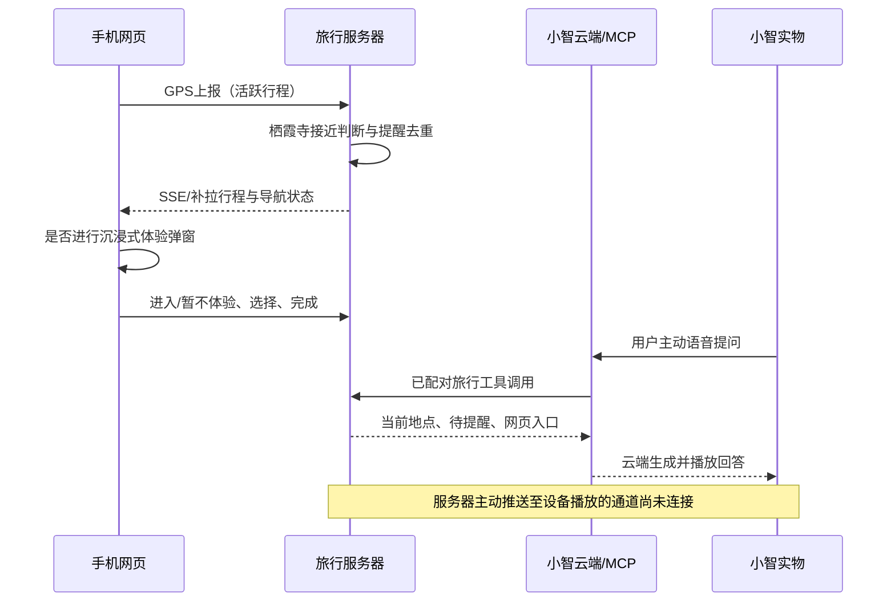

# 沉浸式体验与小智主动提醒接入条件

2026-10-31：用户尚不确定实物固件，授权先完成网页并查明条件。网页已发布 immersive-r6；不刷机、不更换设备固件。本说明基于当前仓库代码，不能据此认定实物安装了相同版本。

## 当前链路

网页和小智共用服务器的行程身份与状态，体验数据进入回忆；网页 iframe 不持有设备或服务凭证。导航仍依赖手机网页定位，并非手表GPS。

## 已查明的约束

- `backend/integrations/xiaozhi/trip-stdio.mjs` 只处理 initialize/ping/tools/list/tools/call，声明的是 tools 能力。MCP 连接不等于设备TTS推送。
- 当前 `mcp_pipe.mjs` 是 JSON-RPC 传输桥，没有已验证的设备播放接口。随意发送TTS字段或MCP通知不能证明设备开口。
- 仓库 `stopwatch-nav/firmware/main/boards/m5stack-stopwatch/local_link_server.cc` 提供 status/echo/image/position/route，未提供 speak/play。
- `stopwatch-nav/firmware/main/application.cc` 校验语音通道/会话，暂停或通道未就绪时忽略 tts/stt/llm。地图页面暂停语音的既有设计必须一并核对。
- 固件具有内置OGG播放能力，可作为未来固定提示音方案，但现有材料不能证明线上设备已开放远程调用。

## 接通主动提醒所需条件

先获取实物固件版本/构建来源，确认团队能否修改和刷写。再选用以下一种真实通道：

1. 小智服务商提供有文档、有鉴权、可定向到当前设备的主动播放接口，且返回设备实际播放确认；须核验该账号和固件支持情况。
2. 定制固件通过有鉴权的出站连接访问VPS，接收固定提示事件，播放内置OGG“栖霞寺有沉浸式体验，请查看网页”。这不依赖公网暴露手表HTTP端口，也不要求任意文本TTS能力。

建议事件包含 reminder_id、trip_id、experience_id、prompt_id、expires_at；通过服务端配对绑定设备，不允许模型指定他人设备。设备先确认收到，在对话空闲且允许播放时执行，记录去重并返回 played_at 或明确失败原因。服务端分别保存 queued/received/played/expired/failed；断线重连不能重复播报已完成事件，过期位置不补播。网页已关闭或已进入体验时应取消尚未播放的提醒。

需专门验收锁屏/网页后台定位、设备忙碌、地图模式、断网重连、重复事件和跨行程解绑。当前 voice_delivery=not_connected；不能把网页弹窗、浏览器音频、工具回答或服务端发出事件标记为设备主动播放成功。
