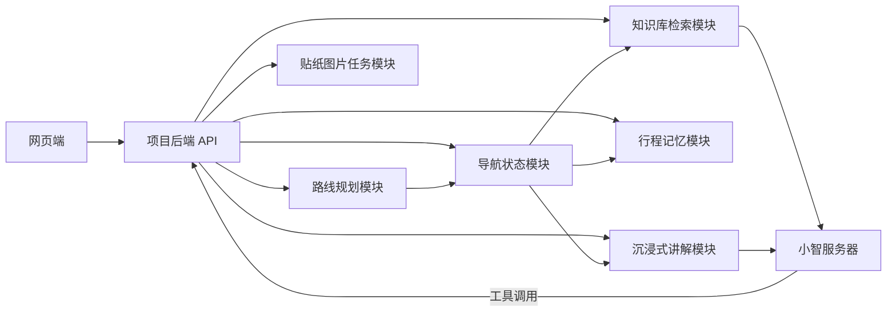

# 后端业务中枢分层建议

> 文档性质：设计提案。2026-10-31从交接目录归入架构目录，保留以下原始建议。未来接口、图片服务和导航状态不代表已经实现；当前MCP部署与验收以[部署记录](https://github.com/WuJiaxuan1/ai-tour-guide-device/blob/e5427df7b238e2b05f78eb9c1b21df7e30806acc/docs/operations/mcp-deployment-20261031.md)为准。

整体方向合理，但需要把“路线规则、导航状态、小智工具、记忆数据、内容生成”分层。现在的方案如果直接串在一起，会出现小智越权规划、客户端伪造位置、路线和记忆数据混乱的问题。

推荐架构：



路线规划应这样处理：

1. 网页端提交：

```json
{
  "tripId": "uuid",
  "entryGate": "west",
  "exitGate": "west",
  "duration": "half",
  "intensity": "easy",
  "senior": true,
  "children": false,
  "preferredPlaceIds": ["mirror-lake"]
}
```

2. 项目后端校验参数。
3. 路线规划模块从正式预设路线中筛选。
4. 返回最多 2–3 条候选路线，包括：

```json
{
  "routeId": "R02",
  "revision": 1,
  "name": "西门古刹人文游",
  "features": ["步道平缓", "人文景点集中"],
  "stops": [],
  "geometry": {},
  "navigationReady": true
}
```

小智不应该直接决定路线，也不应该绕过后端读取数据库。小智只负责理解用户语言，然后调用后端工具，例如：

- `recommend_routes`
- `get_current_trip_context`
- `get_next_stop`
- `explain_current_place`
- `get_trip_summary`

当前项目已有路线接口、知识库接口和高德路线能力，但小智网页文字通道仍未打通，不能把“调用小智”写成已经完成的能力。

有一个重要限制：现有资料的筛选表并不能保证所有条件都有 2–3 条路线。系统应返回：

- `matched`
- `no_match`
- `unverified`

如果不足 2–3 条，应该显示实际结果，或者在用户同意后放宽条件，不能强行补路线。

导航模块应由网页获取手机 GPS，但服务器负责维护权威状态。建议每 5–15 秒或移动超过 20–50 米上传一次：

```json
{
  "tripId": "uuid",
  "routeId": "R02",
  "routeRevision": 1,
  "location": [118.9563, 32.1517],
  "accuracyMeters": 12,
  "heading": 90,
  "speedMetersPerSecond": 1.2,
  "capturedAt": "2026-10-30T15:20:00Z"
}
```

后端根据路线几何计算：

- 当前所在路段
- 当前景点
- 下一站景点
- 剩余距离
- 剩余步行时间
- 是否到达
- 是否偏离路线
- 是否触发沉浸式讲解

不能直接相信浏览器上传的“当前景点”和“剩余时间”，这些字段应由服务器根据坐标和路线计算。当前项目已有 WGS84 转 GCJ02 和高德地图基础，但还需要补齐路线状态服务。

问答模块建议分两条入口，共用一个后端上下文：

- 语音：小智调用 `get_current_trip_context` 和 `explain_current_place`。
- 网页问枫枫：网页请求项目后端，后端再调用知识检索或小智接口。

知识库上传到小智服务器时，需要保留：

- 景点 ID
- 别名
- 景点坐标
- 知识来源
- 知识版本
- 适用路线
- 可讲解的语音片段

当前知识库只能保证有限检索和多轮规则对话，尚未接入小智的正式网页传输、鉴权和流式协议。这个接口需要先由团队提供。

记忆管理不建议只保存聊天文本。应同时保存结构化事件：

```text
trip_started
route_selected
location_updated
stop_arrived
place_explained
user_question
place_favorited
trip_finished
```

行程结束后由后端根据结构化数据生成摘要，例如：

- 游览了几个景点
- 实际游览时长
- 计划路线与完成情况
- 停留时间最长的地点
- 用户主动询问最多的地点
- 用户收藏或标记的景点

模型只负责生成文字表达，景点数量、时间和路线名称必须来自结构化数据，不能让模型自行计算。

贴纸功能应与路线记忆解耦：

1. 前端选择照片或预设风景图。
2. 后端创建图片任务。
3. 贴纸生成服务处理。
4. 返回 `jobId` 和结果图片。
5. 前端提供预览和下载。

需要注意，当前项目里的“专属手账”仍是本地固定图片和模拟处理动画，还不是服务器调用贴纸生成 skill。`travel-memory-sticker-card` 或 imagegen skill 也不能直接等同于线上后端服务，需要确定实际调用方式、任务队列和图片存储位置。

沉浸式讲解模块适合单独做成“景点剧情页面”：

- 每个景点绑定一个历史人物视角。
- 内容由预先审核的章节和选项组成。
- 用户选择后推进剧情。
- 到达景点时由导航状态触发提示。
- 小智只朗读已审核内容，不自由编造历史。

触发条件要有防抖，例如进入景点 50 米范围后持续 10 秒才触发，离开后不重复播放。GPS 精度不足时应提示无法确认到达，不能误触发。

我建议最终拆成五个后端域：

| 域 | 作用 |
|---|---|
| Route Service | 偏好校验、预设路线筛选、路线版本 |
| Navigation Service | GPS、地图路径、当前站点、剩余距离 |
| Knowledge Service | 知识检索、来源、讲解上下文 |
| Memory Service | 行程事件、摘要、用户记忆 |
| Media Service | 贴纸图片、预设素材、下载任务 |

当前最需要先确认的不是页面，而是四个接口合同：

1. 小智服务器如何调用项目后端工具，鉴权和回调格式是什么。
2. 正式路线是否保证每个点都有坐标、道路几何、入口出口和版本号。
3. 用户位置是否允许上传服务器，保存多久，是否支持匿名 `tripId`。
4. 贴纸生成 skill 是本地调用、服务器调用，还是由小智工具调用。

结论是：**总体架构可以采用，但必须以项目后端作为唯一业务中枢，小智只做语言交互和工具调用，模型不能直接拥有路线、位置、知识和记忆的写入权限。**
